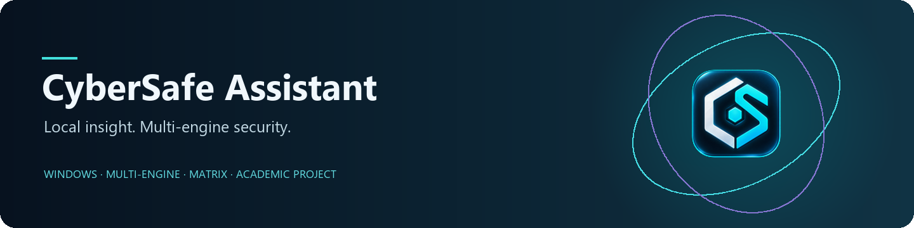
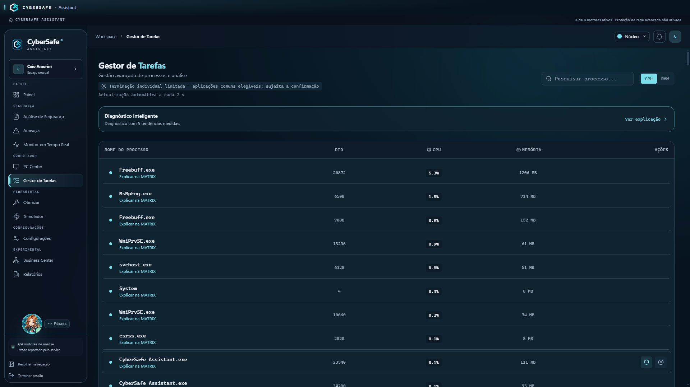
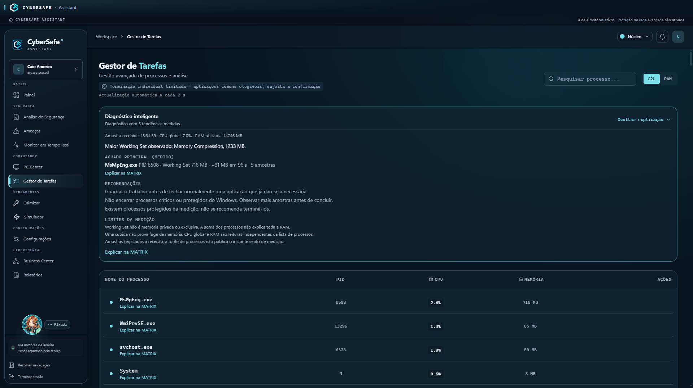
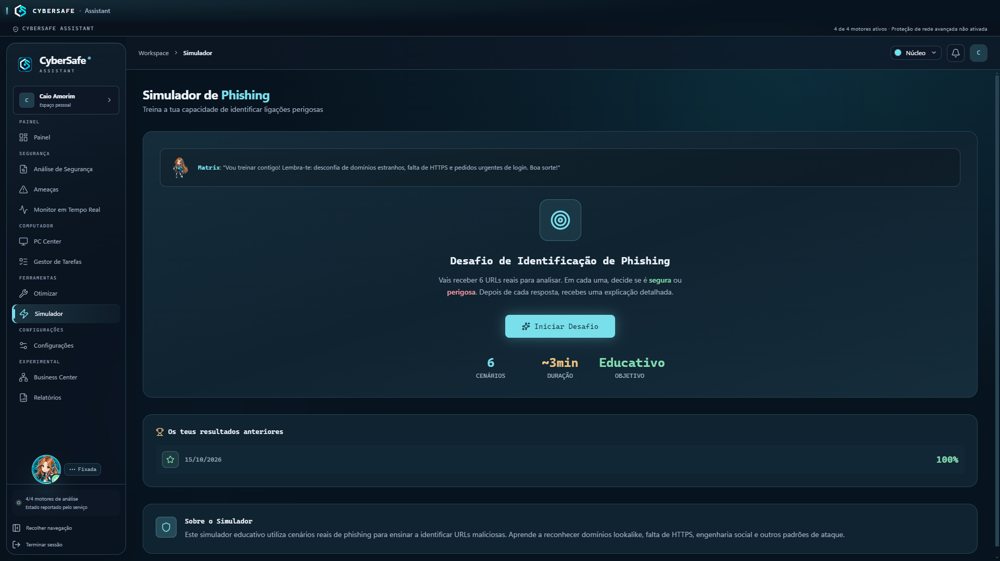
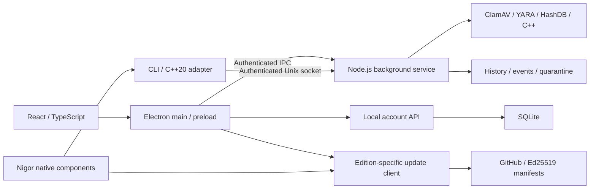

<b>English</b> · <a href="README.pt-PT.md">Português de Portugal</a>

**CyberSafe Assistant brings multi-engine file analysis, system diagnostics and contextual assistance to a desktop interface.** Windows is the stable distribution. Arch Linux and Nigor OS have experimental packages with their own compatibility and validation boundaries.

Created by **Caio Amorim**, the project began as Portugal's **Prova de Aptidão Profissional (PAP)** and continues in development. It combines **Electron, React, TypeScript, Node.js, SQLite and C++** with ClamAV, YARA and hash-based analysis.

[Downloads](docs/downloads.md) · [Documentation](docs/README.md) · [Contribute](CONTRIBUTING.md) · [Security](SECURITY.md) · [Roadmap](docs/roadmap-public.md)

## Choose your edition

| Platform | Available release | Requirements and behavior | Start here |
|---|---|---|---|
| **Windows** | **Stable v0.2.4** | Windows 10/11 x64. Manual installation. Setup currently lacks Authenticode. | [Download](https://github.com/MatrixChill/cybersafe-assistant/releases/tag/v0.2.4) · [Install and recover](docs/installation.md) |
| **Linux / Arch** | **Experimental Preview 3**, package 0.2.4-3 | Arch x86_64/glibc, pacman and declared dependencies. Account-based desktop entry. | [Download](https://github.com/MatrixChill/cybersafe-assistant/releases/tag/linux-v0.2.4-arch-preview.3) · [Linux guide](docs/linux/README.md) |
| **Nigor OS Edition** | **Experimental Preview 1**, package 0.2.4-2 | Arch-based Nigor x86_64. Dedicated package, local panel without an account and optional login. | [Download](https://github.com/MatrixChill/cybersafe-assistant/releases/tag/nigor-v0.2.4-preview.1) · [Nigor guide](docs/nigor-os/README.md) |

The Nigor preview number and Arch package revision identify different things. Preview 1 ships package **0.2.4-2**. The two Arch packages conflict and require an explicit migration. The [download index](docs/downloads.md) lists exact assets, checksums and channel status. Historical Debian/AppImage builds have their own documented limits.

## Features and platform boundaries

| Area | Available capability | Boundary |
|---|---|---|
| **Scanner** | Quick/custom scans, cancellation, per-engine results, history and PDF reports. | Review the exact edition. An inconclusive result or engine failure is incomplete analysis. |
| **ClamAV** | Signature matching and supported archive inspection. | Definitions, archive limits, database loading and timeouts affect detection. Linux persistent clamd is optional and uses significant memory. |
| **YARA / HashDB / Native C++** | Rules, known hashes, hashing, entropy and heuristic signals. | Coverage is limited to the rules, hashes and analyses actually available. |
| **Monitoring / quarantine** | File and process observation, queue recovery, isolation, metadata and controlled restoration. | Monitoring has coverage gaps. Linux detects after writing; preventive blocking is not enabled in the distributed edition. Cross-filesystem quarantine has lab evidence. |
| **History / reporting** | Persisted scan results and contextual diagnostics. | Historical evidence keeps its original version and environment. |
| **PC Center / Task Manager** | Available system, hardware and process metrics. | Sensors vary by OS and device. Protected Windows process termination is platform-specific. |
| **MATRIX** | Local explanations and optional online provider. | Online use requires configuration and consent. A local response does not establish that a provider answered. |
| **USB / diagnostics** | Supported device analysis, dependency checks and coverage diagnostics. | A lab filesystem test does not demonstrate every physical USB device. |
| **Updates** | GitHub discovery, Ed25519 manifests, SHA-256 and explicit installation requests. | Windows uses manual installation. Linux/Nigor use distinct channels and client compatibility gates. [Update status](docs/downloads.md#update-channels). |
| **Nigor integration** | Authenticated local client, JSON contract, C++20 adapter, reference Security Center and user service. | Nigor supplies its own bar, desktop, notification system, polkit agent and session keyring. Physical integration remains to be validated. |

## Real interface captures

**Archived v0.2.0 Windows screenshots.** These illustrate actual historical interfaces. Current v0.2.4, Arch and Nigor screenshots still require version-labelled, privacy-reviewed capture. The [image index](docs/images/README.md) records the original files and the [demo script](docs/demo.md) describes a benign recording.

More historical interfaces

## Architecture

Named pipes serve Windows and authenticated Unix sockets serve Linux. The account API and local service use distinct authentication mechanisms. Nigor's optional account does not remove service authentication. The updater verifies metadata and bytes before an authorized installer request. [Architecture guide](docs/architecture/README.md).

## Install and use

Use the assets from the same [release for your edition](docs/downloads.md), verify the checksum, and preserve a cold backup before upgrading. Start with a small folder of disposable benign files. Inspect engine state, results and history before drawing a conclusion.

[Windows installation](docs/installation.md) · [Linux / Arch](docs/linux/README.md) · [Nigor installation and migration](docs/nigor-os/README.md) · [FAQ](docs/faq.md)

## Development and contributions

The [development guide](docs/development.md) covers source branches, Node.js, native dependencies, Arch packaging and focused tests. Linux/Nigor work is under review in [PR #5](https://github.com/MatrixChill/cybersafe-assistant/pull/5). This documentation is reviewed in [PR #4](https://github.com/MatrixChill/cybersafe-assistant/pull/4).

Report reproducible bugs, review documentation, translate guides or contribute scoped changes. Include the edition, release/package version and actual test environment. Read [CONTRIBUTING](CONTRIBUTING.md), [support](docs/support.md) and the [Code of Conduct](CODE_OF_CONDUCT.md).

## Security, evidence and roadmap

CyberSafe has no certified or complete malware-coverage claim. Keep the platform's protections enabled. Watcher events, Active engines and passing CI each demonstrate different things. The [security policy](SECURITY.md) explains limitations and the current vulnerability-reporting path.

Windows v0.2.4 addresses ClamAV lifecycle recovery. Linux/Nigor lab work covers batching, optional clamd, safe staging and cross-filesystem quarantine. Full Nigor desktop acceptance, broader device validation and an installed update through the graphical authorization path remain explicit gates. See the [public roadmap](docs/roadmap-public.md) and each edition's guide for evidence and remaining work.

## Author, license and history

**Caio Amorim** created CyberSafe for the PAP and continues its development. The [academic evidence](PAP-EVIDENCIAS-TECNICAS/README.md), dated checkpoints and [archive guide](docs/archive/README.md) preserve their original context.

Original project code is licensed under the owner-approved [MIT License](LICENSE). Third-party software and assets retain their licenses. [Licensing and provenance](docs/licensing.md) explains the scope, attribution records and distribution obligations.

[Changelog](CHANGELOG.md) · [MATRIX](docs/matrix.md) (PT-PT) · [Technical architecture](docs/ARCHITECTURE.md) (PT-PT)
