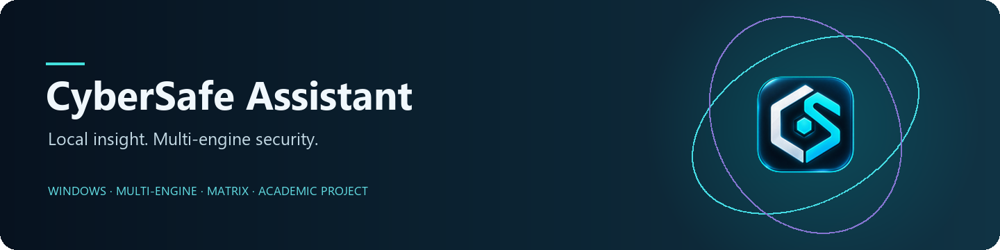
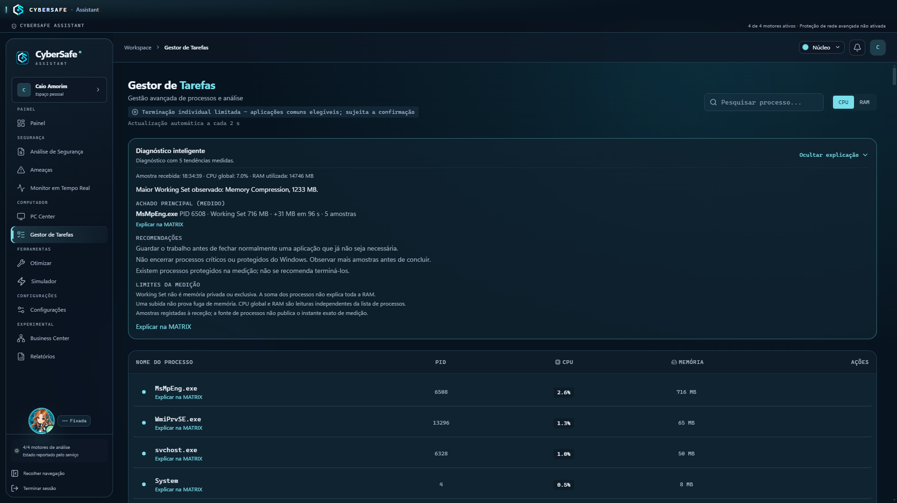
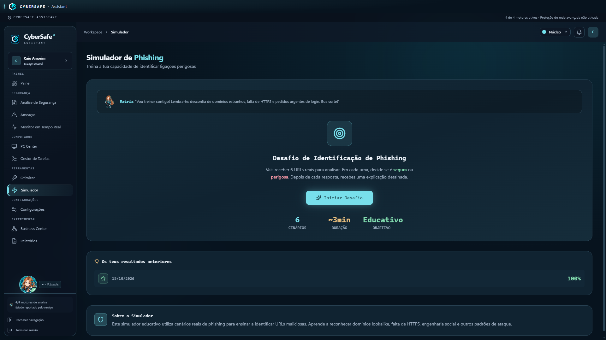
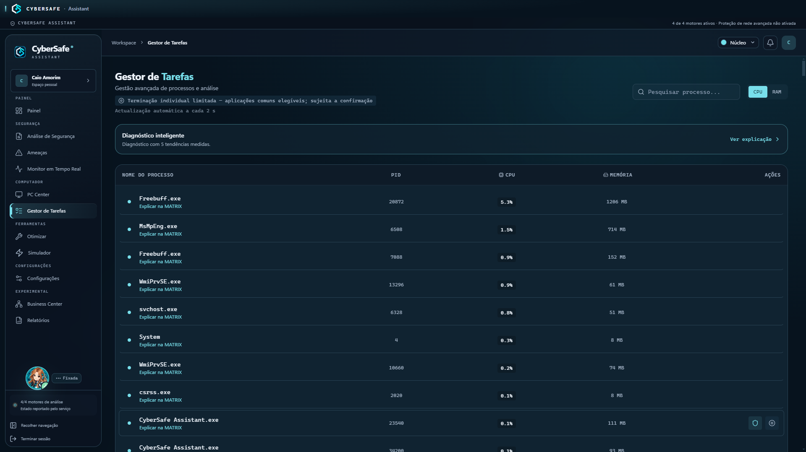
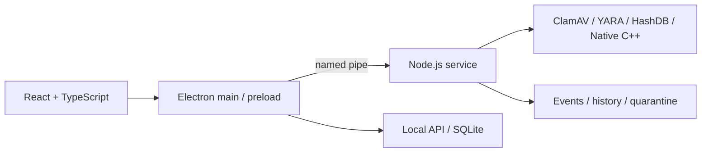

<p align="center"><a href="README.pt-PT.md"><b>Português de Portugal</b></a> · English</p>



<p align="center">
<a href="https://github.com/MatrixChill/cybersafe-assistant/releases/latest"></a>
<a href="https://github.com/MatrixChill/cybersafe-assistant/actions/workflows/ci.yml"></a>

<a href="docs/licensing.md"></a>
</p>

<p align="center"><a href="https://github.com/MatrixChill/cybersafe-assistant/releases/latest"><b>Download for Windows</b></a> · <a href="docs/README.md">Documentation</a> · <a href="CONTRIBUTING.md">Contribute</a> · <a href="docs/faq.md">FAQ</a></p>

**CyberSafe Assistant brings file analysis, system monitoring and contextual assistance into one Windows desktop app.** Compare results from four engines, inspect available process metrics, review scan history and ask MATRIX to explain the context.

Created by **Caio Amorim** for Portugal's **Prova de Aptidão Profissional (PAP)**, CyberSafe is an academic security project with public source. It complements Windows protection; it does **not** replace Microsoft Defender or claim certified, complete malware coverage. Project licensing is [pending clarification](docs/licensing.md).

## Explore CyberSafe

| Area | What you can do | What to keep in mind |
|---|---|---|
| **Scanner** | Run quick or custom scans, cancel work, review history and export PDF reports. | Inconclusive results and engine failures are not clean verdicts. |
| **Four engines** | Combine ClamAV, YARA, HashDB and Native C++ results. | Each engine has different coverage; availability is not a detection guarantee. |
| **Real-time monitor** | Follow file/process events and inspect coverage diagnostics. | Windows notifications, queue pressure and timeouts can leave gaps. |
| **Quarantine** | Isolate and restore through identity, destination and consent checks. | Do not restore suspicious files merely to test. |
| **MATRIX** | Ask for local process explanations and diagnostics; optionally configure an online provider. | Online requests require configuration and consent. Missing measurements remain unknown. |
| **PC Center / Task Manager** | Inspect available hardware/process metrics and use protected individual termination. | Sensor availability varies. Termination requires explicit confirmation. |
| **Tools / USB** | Review optimization recommendations and supported device analysis. | Automated USB tests do not prove coverage on every physical device. |
| **Updates** | Discover GitHub releases and verify signed manifests and download integrity. | Assisted installation is disabled pending legitimate Authenticode signing. |

### A look inside

**Real screenshots from v0.2.0 — historical UI reference, not evidence for v0.2.4.** The current release is **v0.2.4**; see its [release notes](https://github.com/MatrixChill/cybersafe-assistant/releases/tag/v0.2.4) for changes. No current-version recording is claimed here.



<details>
<summary>MATRIX and Task Manager — actual v0.2.0 screenshots</summary>




</details>

**Try a benign demonstration:** scan a small folder of your own text files, open its history entry, then ask MATRIX to explain a selected process. Show the response origin and only measurements actually available. A [60–90 second recording script](docs/demo.md) is ready for a real, version-labelled recording; no video was recorded for this documentation update.

## Install on Windows

**Target platform:** Windows 10/11, x64. Keep Microsoft Defender, SmartScreen, UAC and the firewall enabled. No minimum RAM or scan-time guarantee is claimed.

1. Download the Setup and `SHA256SUMS.txt` from the **same [official release](https://github.com/MatrixChill/cybersafe-assistant/releases/latest)**.
2. Calculate the Setup's hash and compare it with its checksum entry:

   ```powershell
   Get-FileHash -Algorithm SHA256 -LiteralPath "<downloaded-setup>.exe"
   ```

3. Before upgrading, exit CyberSafe normally and back up its persistent data, including databases and quarantine metadata.
4. Run the verified Setup if Windows policy permits. Open the app and check its version, session and engine states.

**The installer has no Authenticode signature.** Windows may identify an unknown publisher. A signed Ed25519 manifest does not make the executable Windows-trusted. If execution is blocked, keep the warning and stop; do not bypass security policy. See the [installation and recovery guide](docs/installation.md).

## How analysis works

| Engine | Role | Coverage boundary |
|---|---|---|
| **ClamAV** | Signature-based analysis and supported archives within engine limits. | Database loading, queue waits and timeouts affect availability and latency. |
| **YARA** | Match the bundled rules using the classic YARA CLI. | Rule loading does not establish broad malware coverage. |
| **HashDB** | Match known file hashes. | Only hashes present in the definitions can match. |
| **Native C++** | File hashing, entropy and heuristic signals, including PE analysis. | Heuristics are signals, not a signature-detection guarantee. |



The npm monorepo separates renderer, desktop shell, local API, background orchestration and native modules. Technologies include **React, Electron, TypeScript, Node.js, SQLite, C++ and CMake**. See [architecture](docs/ARCHITECTURE.md) (PT-PT) and [engine details](docs/engines.md) (PT-PT).

## Limits and evidence

- An **Active** engine is not proof of full coverage. Watcher gaps, inaccessible paths, timeouts and inconclusive scans remain relevant.
- The v0.2.4 ClamAV lifecycle fix is published; confirmation on the affected notebook remains pending in [PR #3](https://github.com/MatrixChill/cybersafe-assistant/pull/3). This is not a universal performance claim.
- WFP requires separate provisioning and does not describe the Windows firewall state.
- MATRIX's local explanations must not be confused with a confirmed external-provider response. Online operation depends on consent, connectivity and provider configuration.
- Ed25519 and SHA-256 validation are implemented. Assisted installation remains disabled without Authenticode; component and handoff tests do not demonstrate an installed end-to-end update.
- CI verifies specified build/test contracts, not installed protection on every Windows device. Historical results retain their original version and environment.

See [security reporting](SECURITY.md), [testing limitations](docs/security-and-testing.md) (PT-PT) and the [public roadmap](docs/roadmap-public.md).

## Develop and contribute

Start with the [development guide](docs/development.md) for Windows prerequisites, isolation and focused tests. Product versioning is defined in `product-version.json`; workspace package versions are not release versions.

Bug reports, documentation review and reproducible observations are welcome in **English or Portuguese**. Read [CONTRIBUTING](CONTRIBUTING.md) and the [Code of Conduct](CODE_OF_CONDUCT.md). Licensing must be clarified before treating the project as OSI-licensed or assuming redistribution permissions. No new license grant is made by this README.

## Project and documentation

[Documentation index](docs/README.md) · [FAQ](docs/faq.md) · [MATRIX](docs/matrix.md) (PT-PT) · [Updates](docs/updates.md) (PT-PT) · [Changelog](CHANGELOG.md) · [PAP evidence](PAP-EVIDENCIAS-TECNICAS/README.md) (PT-PT)

CyberSafe's academic origin and original evidence remain part of the project. The separate [Linux Lite branch](https://github.com/MatrixChill/cybersafe-assistant/tree/experimental/linux-lite) is experimental and does not imply feature parity with Windows.

Third-party notices and provenance are preserved in [THIRD-PARTY-NOTICES](assets/licenses/THIRD-PARTY-NOTICES.txt) and [PROVENANCE](assets/licenses/PROVENANCE.json). Their historical sections are labelled; they do not grant a project-wide license. See [licensing status](docs/licensing.md).
