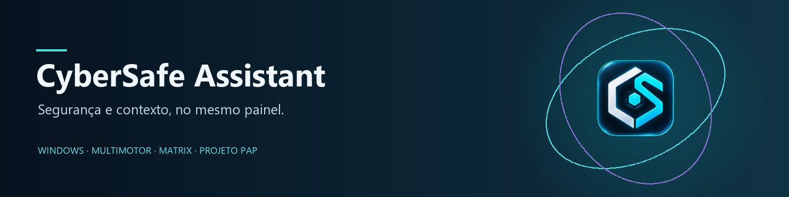
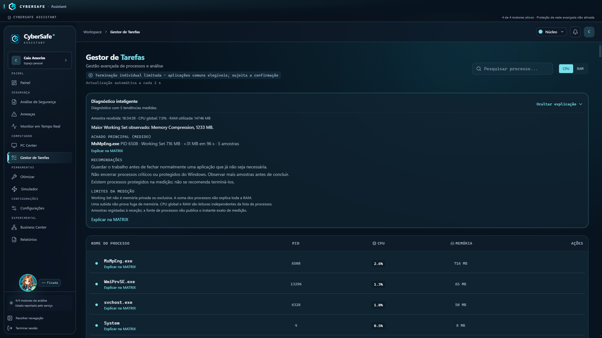
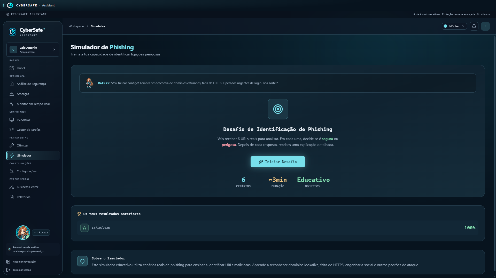
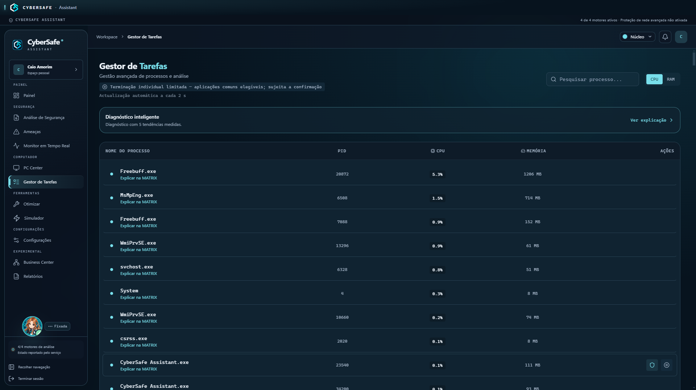
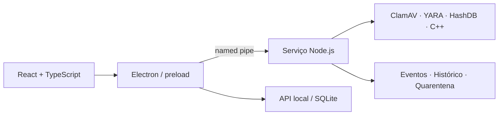

<p align="center"><a href="README.md"><b>English</b></a> · Português de Portugal</p>

<p align="center"></p>



<p align="center">
<a href="https://github.com/MatrixChill/cybersafe-assistant/releases/latest"></a>
<a href="https://github.com/MatrixChill/cybersafe-assistant/actions/workflows/ci.yml"></a>


<a href="docs/licensing.md"></a>
</p>

<p align="center"><a href="https://github.com/MatrixChill/cybersafe-assistant/releases/latest"><b>Descarregar para Windows</b></a> · <a href="docs/README.md">Documentação</a> · <a href="https://github.com/MatrixChill/cybersafe-assistant/tree/experimental/linux-lite">Linux Lite experimental</a></p>

O **CyberSafe Assistant** é uma aplicação desktop de segurança para Windows. Reúne análise de ficheiros com quatro motores, monitorização do sistema, quarentena e assistência MATRIX numa interface comum.

Criado por **Caio Amorim** no âmbito da **Prova de Aptidão Profissional**, explora a integração entre software desktop, componentes nativos e decisões de segurança explicáveis. É um projeto académico: complementa as proteções do Windows e apresenta limitações quando uma análise não pode ser concluída.

**Licença por clarificar:** não existe texto global aprovado na raiz. Consulte o [estado da licença](docs/licensing.md) antes de assumir permissões de reutilização.

## O que pode fazer

| Área | Funcionalidades |
|---|---|
| **Scanner** | Análises rápidas e personalizadas, progresso, cancelamento, histórico e relatórios PDF. |
| **Quatro motores** | ClamAV, regras YARA, HashDB e análise nativa em C++. Estados de saúde e resultados inconclusivos explícitos. |
| **Monitorização** | Eventos de ficheiros e processos, recuperação de filas e diagnóstico de lacunas de cobertura. |
| **Quarentena** | Isolamento e restauro controlado, com metadados e verificações de identidade e destino. |
| **MATRIX** | Diagnóstico local e explicação de processos; IA online opcional com configuração e consentimento. |
| **PC Center e Gestor de Tarefas** | Métricas disponíveis do sistema e terminação individual protegida no Windows. |
| **USB e ferramentas** | Análise de dispositivos autorizados, recomendações e operações de otimização. |
| **Atualizações** | Descoberta de versões no GitHub e verificação Ed25519/SHA-256. Instalação manual enquanto não existir Authenticode. |

## Ver a aplicação

<details>
<summary>Capturas reais — versão pública v0.2.0 (referência histórica)</summary>





Estas capturas são da **v0.2.0**, não demonstram o estado da v0.2.4. Preservadas como evidência real; não são mockups nem imagens de laboratório. As alterações mais recentes estão nas [notas da release](https://github.com/MatrixChill/cybersafe-assistant/releases/latest).

</details>

## Instalar no Windows

1. Descarregue o Setup e `SHA256SUMS.txt` da [release oficial](https://github.com/MatrixChill/cybersafe-assistant/releases/latest).
2. Compare o hash do ficheiro com a linha correspondente em `SHA256SUMS.txt`:

   ```powershell
   Get-FileHash -Algorithm SHA256 -LiteralPath "<caminho-do-setup>.exe"
   ```

3. Ao atualizar, encerre normalmente a aplicação e preserve um backup dos dados antes de executar o Setup oficial.
4. Confirme a versão, a sessão e o estado dos motores após abrir.

**Compatibilidade:** Windows 10/11 x64. O instalador não tem assinatura Authenticode; o Windows pode mostrar editor desconhecido. Se uma política bloquear a execução, conserve o aviso e não desative Defender, SmartScreen, UAC ou firewall. [Guia de instalação e atualização](docs/installation.pt-PT.md).

## Como funciona



O monorepo separa interface, shell desktop, API local, orquestração e motores nativos. Usa **React, Electron, TypeScript, Node.js, C++, SQLite e CMake**. [Arquitetura e contratos](docs/ARCHITECTURE.md).

## Desenvolver

```powershell
git clone https://github.com/MatrixChill/cybersafe-assistant.git
cd cybersafe-assistant
npm ci
npm run build:all
npm run dev
```

O build nativo requer o toolchain Windows e os recursos documentados. Evite executar uma sessão DEV em conflito com uma instalação pessoal. Os testes e o packaging são etapas distintas; `build:all` não gera nem valida uma instalação. [Preparar o ambiente e executar testes](docs/development.pt-PT.md).

## Segurança e limites

- Motor **Ativo** não certifica cobertura total. Falhas, timeouts e resultados inconclusivos devem permanecer visíveis.
- A correção ClamAV da v0.2.4 está publicada; a confirmação no portátil afetado continua pendente nas notas do PR #3.
- A cobertura do watcher é limitada pelas notificações do Windows. USB tem testes automatizados; isso não substitui um ensaio com dispositivo físico.
- O filtro WFP depende de provisionamento próprio; não representa o estado do firewall do Windows.
- O updater verifica manifesto e integridade; a instalação assistida permanece desativada. Não há promessa de atualização automática ponta a ponta.

Não é uma proteção antivírus infalível nem substitui o Microsoft Defender. [Testes, limitações e divulgação de vulnerabilidades](docs/security-and-testing.md).

## Documentação e PAP

[Índice técnico](docs/README.md) · [Motores](docs/engines.md) · [MATRIX](docs/matrix.md) · [Atualizações](docs/updates.md) · [Evidências da PAP](PAP-EVIDENCIAS-TECNICAS/README.md) · [Changelog](CHANGELOG.md)

A [branch Linux Lite](https://github.com/MatrixChill/cybersafe-assistant/tree/experimental/linux-lite) é experimental e não implica equivalência com a edição Windows. As capturas, relatórios e decisões históricas mantêm a versão e o contexto originais.

As atribuições de terceiros e a proveniência dos componentes estão em [THIRD-PARTY-NOTICES](assets/licenses/THIRD-PARTY-NOTICES.txt) e [PROVENANCE](assets/licenses/PROVENANCE.json).

## Contribuir e acompanhar

Aceitam-se relatos reproduzíveis e revisão documental em português ou inglês. Consulte [CONTRIBUTING](CONTRIBUTING.md), o [Código de Conduta](CODE_OF_CONDUCT.md), a [política de segurança](SECURITY.md), o [FAQ](docs/faq.md) e o [roadmap público atual](docs/roadmap-public.md) (em inglês).

**Licença por clarificar:** os metadados npm indicam MIT, mas não existe texto global aprovado na raiz. O proprietário confirmou esta pendência. Não se atribuem novos direitos nem se apresenta uma licença OSI como confirmada. [Estado da licença e atribuições](docs/licensing.md).

Está preparado um [guião de demonstração de 60–90 segundos](docs/demo.md), em inglês e PT-PT. Não representa uma gravação já executada.
