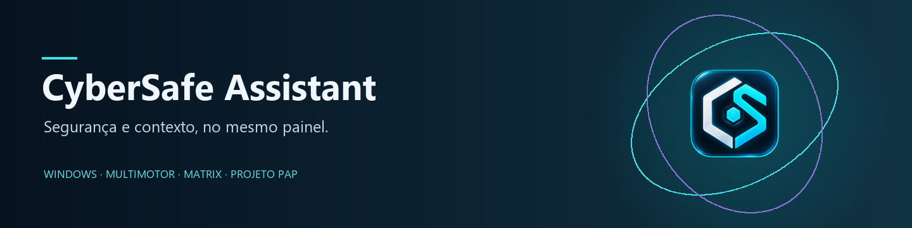
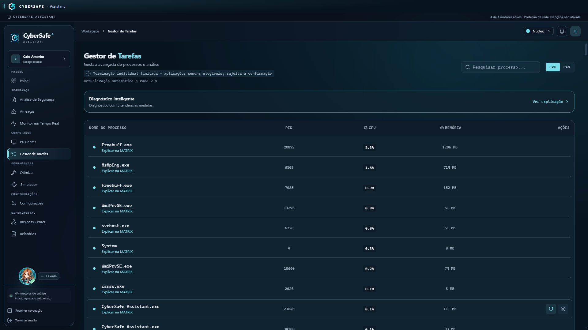
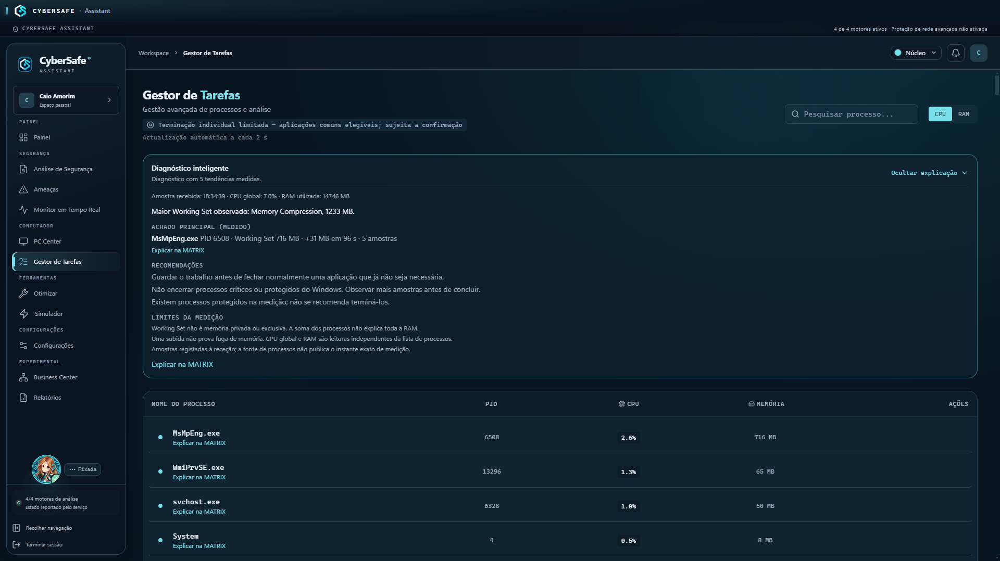
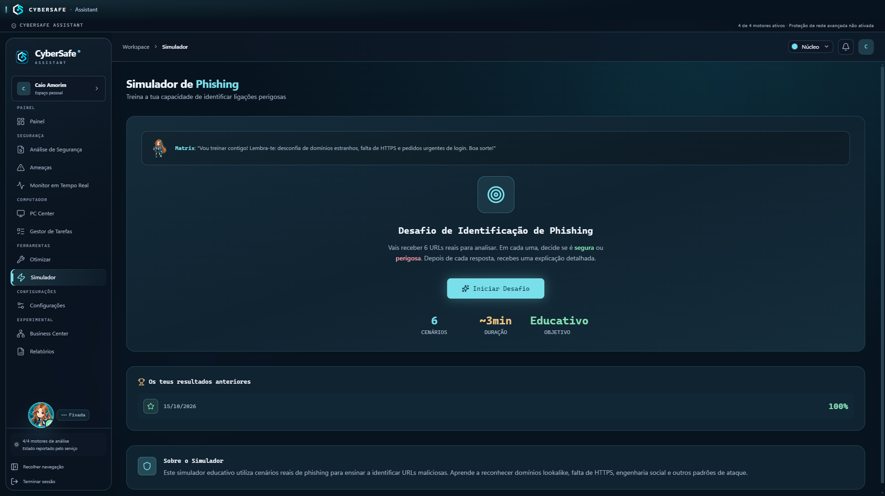
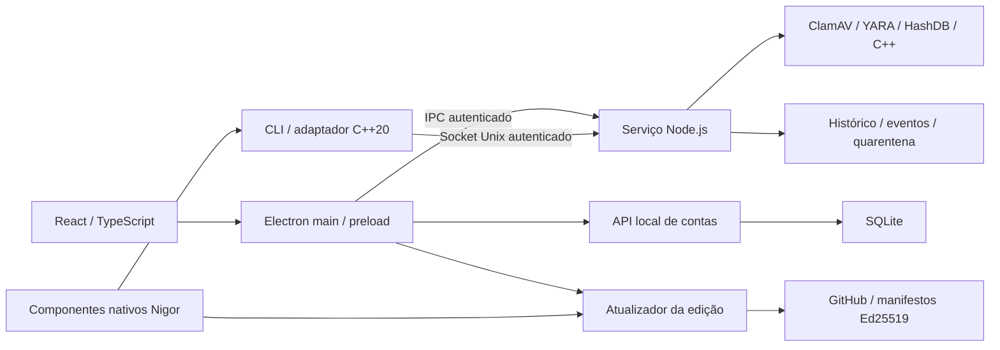

<a href="README.md">English</a> · <b>Português de Portugal</b>

**O CyberSafe Assistant reúne análise de ficheiros com vários motores, diagnóstico do sistema e assistência contextual numa interface desktop.** O Windows é a distribuição estável. Arch Linux e Nigor OS têm pacotes experimentais, com compatibilidade e validação próprias.

Criado por **Caio Amorim**, começou na **Prova de Aptidão Profissional (PAP)** e continua em desenvolvimento. Combina **Electron, React, TypeScript, Node.js, SQLite e C++** com ClamAV, YARA e análise por hashes.

[Downloads](docs/downloads.pt-PT.md) · [Documentação](docs/README.md) · [Contribuir](CONTRIBUTING.pt-PT.md) · [Segurança](SECURITY.md) · [Roadmap](docs/roadmap-public.md)

## Escolher a edição

| Plataforma | Release disponível | Requisitos e comportamento | Começar |
|---|---|---|---|
| **Windows** | **Estável v0.2.4** | Windows 10/11 x64. Instalação manual. Setup ainda sem Authenticode. | [Download](https://github.com/MatrixChill/cybersafe-assistant/releases/tag/v0.2.4) · [Instalação e recuperação](docs/installation.pt-PT.md) |
| **Linux / Arch** | **Experimental Preview 3**, pacote 0.2.4-3 | Arch x86_64/glibc, pacman e dependências declaradas. Entrada na interface com conta. | [Download](https://github.com/MatrixChill/cybersafe-assistant/releases/tag/linux-v0.2.4-arch-preview.3) · [Guia Linux](docs/linux/README.pt-PT.md) |
| **Nigor OS Edition** | **Experimental Preview 1**, pacote 0.2.4-2 | Nigor baseado em Arch x86_64. Pacote próprio, painel local sem conta e login opcional. | [Download](https://github.com/MatrixChill/cybersafe-assistant/releases/tag/nigor-v0.2.4-preview.1) · [Guia Nigor](docs/nigor-os/README.pt-PT.md) |

O número da Preview Nigor e a revisão do pacote Arch identificam coisas diferentes. A Preview 1 inclui o pacote **0.2.4-2**. Os dois pacotes Arch entram em conflito e a migração é explícita. O [índice de downloads](docs/downloads.pt-PT.md) apresenta assets, checksums e canais. Os antigos pacotes Debian/AppImage mantêm os seus limites documentados.

## Funcionalidades e limites por plataforma

| Área | Capacidade disponível | Limite |
|---|---|---|
| **Scanner** | Análises rápidas/personalizadas, cancelamento, resultados por motor, histórico e relatórios PDF. | Consultar a edição concreta. Um resultado inconclusivo ou uma falha de motor deixa a análise incompleta. |
| **ClamAV** | Assinaturas e análise dos arquivos suportados. | Definições, limites dos arquivos, carregamento e timeouts afetam a deteção. O clamd persistente Linux é opcional e ocupa memória significativa. |
| **YARA / HashDB / C++ nativo** | Regras, hashes conhecidos, cálculo de hashes, entropia e sinais heurísticos. | A cobertura depende das regras, hashes e análises realmente disponíveis. |
| **Monitorização / quarentena** | Observação de ficheiros e processos, recuperação de filas, isolamento, metadados e restauro controlado. | Há lacunas de cobertura. O Linux deteta após escrita e a edição distribuída mantém a prevenção desativada. A quarentena entre sistemas de ficheiros tem evidência de laboratório. |
| **Histórico / relatórios** | Resultados persistentes e diagnóstico contextual. | Evidência histórica conserva a versão e o ambiente originais. |
| **PC Center / Gestor de Tarefas** | Métricas disponíveis de hardware, sistema e processos. | Os sensores variam. A terminação protegida Windows é específica dessa plataforma. |
| **MATRIX** | Explicações locais e fornecedor online opcional. | O uso online exige configuração e consentimento. Uma resposta local não comprova resposta do fornecedor. |
| **USB / diagnóstico** | Análise dos dispositivos suportados, dependências e cobertura. | Um ensaio de sistemas de ficheiros não demonstra todos os dispositivos USB físicos. |
| **Atualizações** | Descoberta GitHub, manifestos Ed25519, SHA-256 e pedidos explícitos de instalação. | O Windows usa instalação manual. Linux/Nigor têm canais e requisitos de compatibilidade próprios. [Estado dos canais](docs/downloads.pt-PT.md#canais-de-atualização). |
| **Integração Nigor** | Cliente local autenticado, JSON, adaptador C++20, Security Center de referência e serviço de utilizador. | Barra, desktop, notificações, agente polkit e porta-chaves pertencem ao Nigor. A integração física continua por validar. |

## Capturas reais da interface

**Arquivo Windows v0.2.0.** São interfaces históricas reais. Ainda faltam capturas atuais de v0.2.4, Arch e Nigor, com versão e revisão de privacidade. O [índice de imagens](docs/images/README.md) identifica os originais e o [guião de demonstração](docs/demo.md) prepara uma gravação benigna.

Outras interfaces históricas

## Arquitetura

O Windows usa named pipes e o Linux usa sockets Unix autenticados. A API de contas e o serviço local têm mecanismos de autenticação distintos. A conta opcional do Nigor preserva a autenticação do serviço. O atualizador verifica metadados e bytes antes de solicitar instalação autorizada. [Guia de arquitetura](docs/architecture/README.pt-PT.md).

## Instalar e utilizar

Use os assets da mesma [release da sua edição](docs/downloads.pt-PT.md), confirme o checksum e preserve um backup frio antes de atualizar. Comece por uma pequena pasta de ficheiros benignos descartáveis. Reveja motores, resultados e histórico antes de concluir.

[Instalação Windows](docs/installation.pt-PT.md) · [Linux / Arch](docs/linux/README.pt-PT.md) · [Instalação e migração Nigor](docs/nigor-os/README.pt-PT.md) · [FAQ](docs/faq.md)

## Desenvolvimento e contribuições

O [guia de desenvolvimento](docs/development.pt-PT.md) cobre branches, Node.js, dependências nativas, packaging Arch e testes dirigidos. O trabalho Linux/Nigor está em revisão no [PR #5](https://github.com/MatrixChill/cybersafe-assistant/pull/5). Esta documentação é revista no [PR #4](https://github.com/MatrixChill/cybersafe-assistant/pull/4).

Pode relatar erros reproduzíveis, rever documentação, traduzir guias ou contribuir com alterações delimitadas. Indique a edição, versão do produto/pacote e ambiente realmente testado. Consulte [CONTRIBUTING](CONTRIBUTING.pt-PT.md), [suporte](docs/support.md) e o [Código de Conduta](CODE_OF_CONDUCT.md).

## Segurança, evidência e roadmap

O CyberSafe não anuncia certificação ou cobertura total de malware. Mantenha as proteções da plataforma ativas. Eventos do watcher, motores Ativos e CI aprovada demonstram aspetos diferentes. A [política de segurança](SECURITY.md) explica limites e o percurso atual para comunicar vulnerabilidades.

A v0.2.4 Windows corrige a recuperação do ciclo de vida ClamAV. O trabalho de laboratório Linux/Nigor cobre lotes, clamd opcional, staging protegido e quarentena entre sistemas de ficheiros. Aceitação do desktop Nigor, mais dispositivos e atualização instalada pelo percurso de autorização gráfica continuam a ser gates explícitos. Consulte o [roadmap público](docs/roadmap-public.md) e os guias de cada edição.

## Autor, licença e histórico

**Caio Amorim** criou o CyberSafe na PAP e continua o seu desenvolvimento. As [evidências académicas](PAP-EVIDENCIAS-TECNICAS/README.md), checkpoints datados e o [guia do arquivo](docs/archive/README.md) conservam o contexto original.

O código original tem a [licença MIT aprovada pelo titular](LICENSE). Software e assets de terceiros conservam as suas licenças. [Licença e proveniência](docs/licensing.md) explica o âmbito, atribuições e obrigações de distribuição.

[Changelog](CHANGELOG.md) · [MATRIX](docs/matrix.md) · [Arquitetura técnica](docs/ARCHITECTURE.md)
